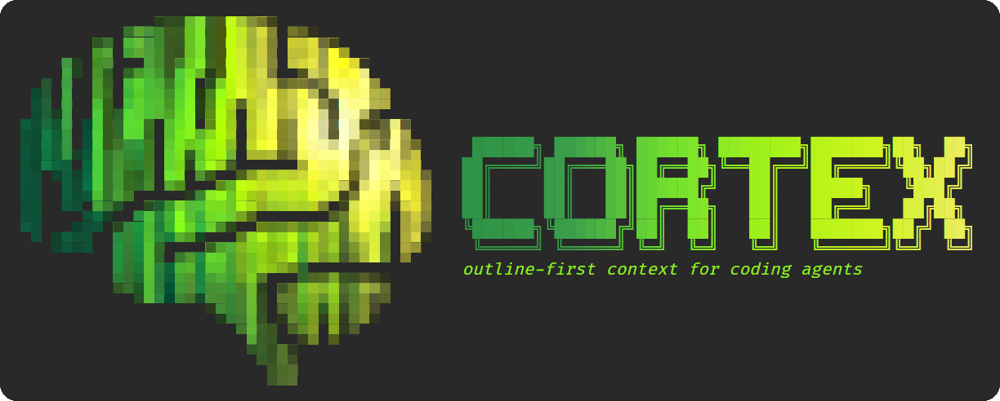
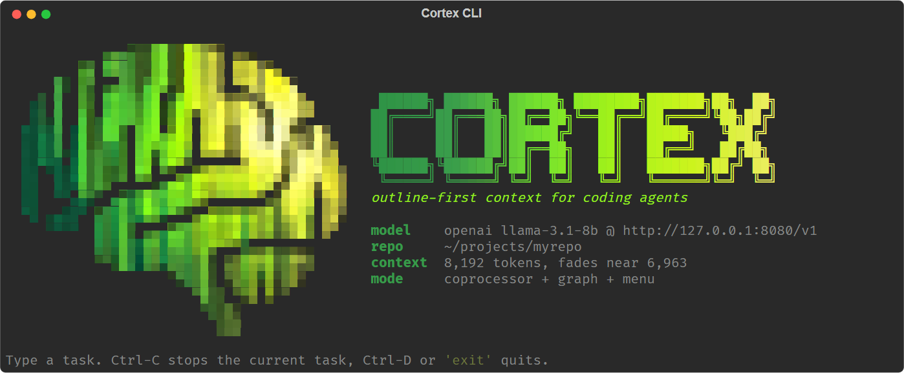
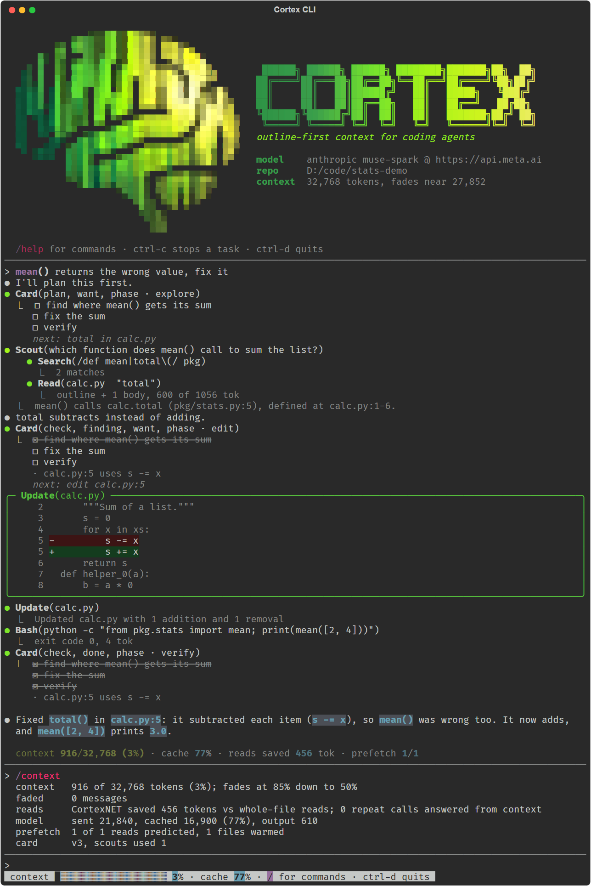

<p align="center">
  
</p>

# CortexNET

<p align="center">
  
</p>

<p align="center">
  
</p>

<p align="center">
  
</p>

<p align="center">
  
</p>

A coding agent normally pulls whole files into its context. CortexNET sits between the agent and the code so it works
from a fraction of that context, with the same or better answers: a small local model on a 6 GB laptop GPU gets
through a long coding session, and hosted models do the same work for a fraction of the tokens and cost.

- **Outline-first reads.** A read returns the file's outline (symbols, line spans, signatures) plus only the bodies the
  next step is likely to need, picked by an include model that learns from the agent's own misses. Anything else is
  one `read_lines` away, and every such request is logged as a miss.
- **Fade on a watermark.** The conversation stays append-only (so a prefix cache keeps working) until it reaches 85%
  of the context, then one batch shrinks stale reads, oldest first, to 50%: superseded copies of a file become a
  pointer, stale reads become their outline or a pointer.

**Two versions.** Locally, **CortexNET** runs next to a model on your own GPU, as a Python library inside your agent
loop (`Reader`, `cortexnet.fade.watermark_fade`). For external sources, API and cloud models, the same core is reached
through **Cortex CLI**, a terminal coding agent made to be tested on API and cloud models (task card, scouts, a spiking
file manager that warms the files the model will want), an egress proxy in front of any agent (Claude Code, Codex,
Antigravity) and an MCP server for any MCP client.

## Meta Global AI Developer Hackathon

**Track: Push the Frontier (software).** CortexNET gives a coding agent a capability it lacks: working through a
repository from a small context window, so an open model on a laptop GPU or a cheap hosted call finishes work that
otherwise overflows the context or costs ten times more.

**Meta models, and where each one runs:**

| model | served by | used for |
|---|---|---|
| Muse Spark 1.3 | Meta Model API (`--meta`, Anthropic-compatible endpoint) | session A/B, SWE-bench Lite, Claude Code through the proxy |
| Muse Spark Open (`meta-models/muse-spark-open-1026`) | Baseten | session A/B, SWE-bench Lite (`bench/swe_api.py --baseten`) |
| Muse Glimmer 30B (open weights) | our own H100s on Modal (`bench/modal_glimmer.py`) | SWE-bench Lite agent A/B, read-time probes |
| Llama 3.3 70B, Llama 4 Maverick | vLLM on Modal H200s (`bench/modal_vllm.py`) | SWE-bench Lite |
| Llama 3.1 8B Instruct | llama.cpp on a 6 GB laptop GPU | session A/B at 8k context |

**What was built during the hackathon: all of it.** Every file in this repository was written in the building period
(27 Oct to 4 Nov 2026); the first commit is dated 27 Oct and `git log` shows each step since. Used, not written here:
numpy, Rich and prompt_toolkit (CLI), llama.cpp and vLLM (serving), MiniLM (an optional coprocessor encoder) and the
public SWE-bench Lite tasks.

## Results

### Meta's models: Muse Spark, Llama 3.3 70B, Llama 4 Maverick (`bench/results/debut.md`)

Same model in every arm, only the read tool changed. Session A/B: 20 code questions in one conversation per arm.
SWE-bench Lite: 40 instances through `bench/swe_api.py` (one harness for Baseten, the Meta API and any
OpenAI-compatible server; Llama 3.3 70B on one Modal H200 and Llama 4 Maverick on four, served by vLLM,
`bench/modal_vllm.py`).

| | whole-file reads | CortexNET |
|---|---|---|
| Muse Spark 1.3 (Meta API), 20-question session | 19/20, $1.91, context 139k at the end | **20/20, $0.18**, context 13k |
| Muse Spark Open (Baseten), 20-question session | 20/20, 2.73M input tokens | 20/20, 16% of the input (12% of the uncached) |
| Muse Spark Open, SWE-bench (40 calls, 120k, submit enforced) | gold symbol 30%, gold file 70% | **gold symbol 48%** (7 won, 0 lost, p = 0.02), gold file 78%; 0.37x file tokens, 0.44x peak context, 1.6x turns |
| Llama 3.3 70B, SWE-bench | gold file 40%, gold symbol 12% | 42% / 8% (n.s.); **0.19x file tokens**, 0.32x peak context, same turns |
| Llama 4 Maverick (400B MoE), SWE-bench, protocol v2 (28 paired) | gold file 61%, gold symbol 21% | gold file 61%, **gold symbol 32%** (5 won, 2 lost, n.s.); **0.31x file tokens**, 0.40x peak context, 1.43x turns |
| Muse Spark 1.3, SWE-bench (20 calls, 60k) | $0.217 per instance; gold symbol 35% | **$0.132 (0.61x)**; gold symbol 38% (n.s.); gold file 55% vs 68%, its extra turns ran into the 20-call cap |

Success on SWE-bench = the submitted file / symbol overlaps the gold patch (no tests are run); one run per
configuration. Lessons from the runs: the call and context limits decided outcomes before the model did (whole-file
reads hit the context limit, CortexNET the call limit), and Muse Spark Open often wrote its fix as text instead of
calling `submit`, more often in CortexNET's longer episodes (unenforced: 10% vs 38% gold symbol); Llama 3.3 70B
submitted a guess on its first turn unless a submit required reading the file. All runs are in `debut.md`.

### CortexNET locally: Llama 3.1 8B on a 6 GB laptop GPU

RTX 3050 Laptop (6 GB), Llama 3.1 8B Instruct Q4_K_M in llama.cpp (`-ngl 99 -c 8192`), 20 code questions about this
repo and the Python standard library, asked **in one conversation per arm** so the context accumulates as in a real
session (`bench/live_ab.py --session`, reports `bench/results/live_ab_llama_3_1_8b_session8k_*.md`):

| arm | correct | first context overflow | input tokens | tool calls | tool output | wall |
|---|---|---|---|---|---|---|
| whole-file reads | 0/20 | question 1 (`reader.py` whole = 15.8k tokens) | - | - | - | - |
| CortexNET reads | 6/20 | question 9 (dead after) | - | - | - | - |
| **CortexNET + fade** | **13/20** | never | 229k | 30 | 63k | 204 s |

- Fade is what keeps a session alive at 8k: the fade arm answered all 20 questions without an overflow, at a median
  5.2k and at most 6.8k tokens of context.
- Accuracy moves with run-to-run noise: llama.cpp is not bit-reproducible here, and the same arm moved by up to 4
  answers between runs at temperature 0.
- How it runs: 5.84 of 6.14 GB VRAM (about 4.4 GB weights, 1.0 GB KV cache reserved for the 8k window, 0.4 GB
  compute), all layers on the GPU, prefill 800-870 tokens/s, generation ~23 tokens/s, median 11 s per question.

One question at a time (`live_ab_llama_3_1_8b_8192.md`): whole-file 3/20 (8 overflows), CortexNET 7/20 (none), with
31% of the input tokens.

### Glimmer 30B on SWE-bench Lite

`bench/swe_agent.py`, `bench/modal_glimmer.py::ab`, report `bench/results/swe_ab.md`. One H100 per arm, the same tasks
with whole-file reads, with CortexNET reads, and with an older per-turn fade. Paired over the 39 tasks every arm
finished (95% CIs from a paired bootstrap over tasks):

| | whole file | CortexNET | CortexNET + per-turn fade |
|---|---|---|---|
| prefill tokens, no prefix cache (the harness re-read the context every turn) | 195k | 0.58x [0.47, 0.71] | 0.56x [0.45, 0.72] |
| prefill tokens with a prefix cache (each context token once) | 18.7k | **0.42x [0.35, 0.50]** | >= 0.36x (lower bound) |
| peak context | 20.4k | 0.47x [0.40, 0.56] | 0.42x [0.36, 0.50] |
| peak KV cache (13 full-attention layers grow, 39 sliding-window layers cap at 2k) | 337 MB | 0.59x [0.53, 0.67] | 0.56x [0.49, 0.63] |
| file tokens put into context | 636k | 33% | 31% |
| turns | 17 | 1.16x [1.02, 1.32] | 1.19x [1.03, 1.38] |
| submitted the gold file / gold symbol | 82% / 41% | 85% / 46% | 82% / 41% |

Task success is unchanged within noise (gold symbol, CortexNET vs whole: 4 tasks only CortexNET solved, 2 only whole,
exact McNemar p = 0.69). The per-turn fade rewrote mid-history on every fade, which forces a re-prefill on a server
with a prefix cache, so its cached cost is only a lower bound; that is why fade was rebuilt as one batch on a
watermark. One whole-file episode ran the 80 GB GPU out of memory (`swe_incident_xarray_4094.md`).

### Hosted Meta models, earlier runs

- **Muse Spark 1.3** (Meta Model API, `bench/live_ab.py --meta`, 14 code questions, one at a time): both arms 14/14;
  CortexNET used 52% of the input tokens and 43% of the cost.
- **Claude Code on Muse Spark 1.3 through the proxy** (`bench/proxy_ab.py`, an audit task): with Meta's prompt cache a
  whole file is paid once and then read at 0.12x, so outline-first reads that add turns cost more per run (round 1:
  1.25x) or about the same (pooled 0.88x, within noise); the intent-aware mode was the cheapest in both its runs
  (n = 2). Outline-first pays where the context is small or uncached, not on a cached hosted API.

## Read-time options

| option | what it does | measured |
|---|---|---|
| `cortexnet.fade.watermark_fade` | one fade batch near the context limit, cache-friendly | keeps 8k sessions alive (laptop table) |
| `Reader(xray_top=2)` | skeletons of big symbols: signature, lines with the query's rare words, control-flow spine (`outline.skeleton`) | +0.029 gold-line recall for ~300 tokens per read (`read_eval.md`) |
| proxy `--shell` | outlines long shell outputs of log-like commands (tests, builds, installs); search results, diffs, listings and printed values are never touched (`cortexnet/shellout.py`) | on 3,203 logged long outputs: the safe rule outlines 1% (saves ~1%); outlining every command saves 36% but hides a third of the words the agent used next (`bench/results/shell_eval.md`), so it is off by default |
| `cortex` spiking file manager (on; `--no-snn` / `CORTEXNET_SNN=0` turns it off) | leaky integrate-and-fire neurons pick the files to warm ahead of the model (below) | replay hit@3 equal to "named file, then recency"; predicts 55% (Llama) / 4% (Claude) of the files the model had not opened yet |
| `Reader(learn_rule="nlms")` | include-model steps normalised by each feature's running mean square | replay: -0.8% read tokens, same hits and misses: off by default |
| `Reader(homeostasis=1.0)` | the include threshold follows the session's miss rate | replay: no change |
| `Reader(refractory=True)` + `watermark_fade(on_fade=reader.forget)` | an unchanged body already in context is not sent again until the fade removes it | replay: no change; laptop session: within noise |
| `watermark_fade(order="charge")` | within a fade pass, the read the agent touched least lately goes first instead of the oldest | laptop session: within noise |

## Spiking file manager

`cortexnet/filesnn.py` decides which files to warm ahead of the model with a layer of leaky integrate-and-fire
neurons, one per file CortexNET knows (the repository index, plus every file the model reads, edits or writes). It
needs no encoder.

- **Inputs.** Four synapses per neuron, each channel's weight shared by every file: *touch*, a nearest-spike trace set
  to 1 when the model uses the file and x0.82 per action (below the rheobase after 12 actions, the gap that covers 90%
  of a session's returns to a file); *path*, a spike when the model's words name the file; *symbol*, a spike when they
  name a symbol only this file (or one other) defines; *habit*, a slow saturating trace of the same touches.
- **Dynamics.** After each model turn (and on the user's request, before the first model call) the inputs drive the
  membranes for one window of 128 clock ticks; a neuron spikes when its membrane crosses the threshold. An inhibitory
  neuron silences the layer once 3 neurons have fired (k-winners-take-all). The first three to spike, in spike order,
  are warmed. A file whose input stays below the rheobase never fires, so a quiet session warms nothing. With constant
  input, first-spike order is the order of input current: the spiking adds the threshold and the early stop, not a
  different ranking.
- **Learning.** An innate population (fixed weights) and a plastic one (a three-factor rule: presynaptic activity x
  the truth minus each neuron's share of a noisy first-spike race, then synaptic scaling) see the same inputs; a gate
  lets the one with the better recent hit@3 drive. State per model: `.cortexnet/agent/files/<model>.npz`.

Replay (`bench/files_replay.py`, `results/files_replay.md`): each model's real file operations in time order, held out
by question for Llama (its 19 runs repeat 20 questions) and by session for Claude (read from the local Claude Code
logs, which keep growing, so its counts move slightly between runs):

| model (held-out predictions) | spiking manager hit@1 / hit@3 | named file, then recency | recency | files not opened yet, predicted |
|---|---|---|---|---|
| Llama 3.1 8B (166) | 48.8% / 65.7% | 65.7% / 65.7% | 37.3% / 37.3% | 55% (recency: 0%) |
| Claude (1,380) | 54.8% / 70.1% | 52.4% / 68.9% | 63.3% / **72.4%** | 4% (recency: 0%) |

What it is worth: its hit@3 equals the simple "named file, then recency" rule (+1.2 points on Claude, 95% interval
+0.1 to +2.2; a tie on Llama) and trails plain recency on Claude by 2.3 points. Recency only ever points at files the
model already read, which are already in the cache, so it warms nothing useful; the manager's useful hits are the
files the model had not opened yet. Learning gained nothing on either model: every learning rate scored the same on
the tuning halves and the gate never handed over to the plastic population. It pays off only for a model whose habit
the innate weights miss (`tests/test_filesnn.py`).

Live: the CLI runs it by default (`/files` shows the next-file guess, agreement, learned weights and spikes; the
status line `snn hit@3`). Through the proxy, `CORTEXNET_SNN=1` gives every model behind it a manager that learns and
reports (`cortexnet-proxy stats`); the proxy sees a read only after the model made it, so there it cannot warm ahead.

**Working set.** `bench/working_set.py` (`results/working_set.md`): over 67 logged sessions, 71% of returns to a file
come on the very next file operation and 90% within 12; an 8-operation window holds a third of a session's files. The
fade's default of keeping the newest 4 results covers about 80% of returns, which is why reordering the fade did not
change the laptop session.

## What did not help, and what was wrong

Measured, see `bench/results/` and the log of every run:

- **A learned body picker** (the Cortex-SubNN coprocessor, with a symbol graph and a connected-symbol menu on top)
  raised per-read recall offline (+0.185 gold-line recall) but solved no more tasks than plain CortexNET reads in any
  live run. It is off by default; design, measurements and studies are in `docs/coprocessor.md`.
- Neural-dynamics options (`bench/results/replay_sessions.md`, 67 sessions; laptop session above), all off by default:
  a homeostatic include threshold changes nothing (the include model's probabilities rarely sit near the threshold);
  refractory bodies change nothing on replay (re-reads there mostly follow edits, so the body changed) and stay within
  noise live; ordering the fade by a leaky touch charge stays within noise live; normalised (NLMS) include-model steps
  save 0.8% of read tokens, too small to switch on.
- **Benchmark pitfalls, fixed.** The laptop session A/B copied the working tree as the agent's workspace, so editing
  the code changed both the questions' corpus and the file list in the system prompt; at temperature 0 Llama 3.1 8B
  then flipped its first action in every arm and scored 0/20. `bench/live_ab.py --fixture-ref <commit>` pins the
  workspace to a commit and `--hint` adds a call example. In session mode on the Meta API the harness chained only
  tool outputs, so questions 2-20 never reached the model; fixed before the runs above.

## Use

```
python -m cortexnet.mcp_server                                # stdio MCP server, no dependencies beyond numpy
claude mcp add cortexnet -- python -m cortexnet.mcp_server    # e.g. register with Claude Code
```

Tools: `cortex_read(path, query?)`, `cortex_range(path, start, end)`, `cortex_outline(path)`, `cortex_stats()`, and
`cortex_approve(ids)` for the experimental connected-symbol menu (`docs/coprocessor.md`). Big
symbols are split into sub-blocks at 600 tokens (`CORTEXNET_SPLIT`, 0 turns it off); `CORTEXNET_POLICY=rule_ab` picks
the cost-aware include rule. State goes to `$CORTEXNET_STATE` or `./.cortexnet/`. Fade for your own agent loop:
`cortexnet.fade.watermark_fade`.

### Cortex CLI: a terminal coding agent

Cortex CLI was made to be tested on API and cloud models.

```
pip install -e .                                   # installs the `cortex` command
cortex                                             # interactive, in the current repo, llama-server on :8080
cortex "make the failing test pass"                # one task, then exit
cortex --api anthropic --base https://api.meta.ai --model muse-spark-1.3 --key-env LLAMA_API_KEY
cortex --api openai --base https://inference.baseten.co/v1 --model meta-models/muse-spark-open-1026 --key-env BASETEN_API_KEY
```

Per-machine defaults for those four flags come from `CORTEX_API`, `CORTEX_BASE`, `CORTEX_MODEL` and `CORTEX_KEY_ENV`
(flags still override them).





*The screenshot is a scripted session (fixed model replies) through the real agent loop, CortexNET reader and UI
code; the cache numbers in it are set by hand.*

Every read goes through CortexNET, the conversation fades on a watermark sized to `--ctx`, and long log-like command
output is outlined. Tools: `read_file`, `read_lines`, `grep`, `list_dir`, `edit_file` (one exact match, shown as a
diff), `write_file`, `run`, `note`, `scout` (and `cortex_approve` for the experimental menu). Edits and commands ask first unless `--yes`; paths cannot leave the
repository; Ctrl-C stops the current task and keeps the session. Backends: any OpenAI-compatible server
(`--api openai`: llama-server, vLLM, Ollama, Baseten, OpenAI) or the Anthropic Messages API (`--api anthropic`, also
the Meta Model API).

The workflow around the reads:

- **Task card** (`note`, `cortexnet/card.py`): the agent's working memory: plan steps it checks off, findings with
  file:line, what it has done, its phase (explore, plan, edit, verify) and `want`, what it will look at next. Each
  update returns the whole card as a tool result, so the history stays append-only (prefix-cache friendly). Fade
  never touches the newest card and turns older copies into pointers, so findings outlive the raw reads they came from.
- **Latent requests and prefetch** (`cortexnet/prefetch.py`, `cortexnet/filesnn.py`): the card's `want` joins every
  read's query, so the bodies picked up front follow the agent's stated intent. Before the first model call and after
  each step, the spiking file manager picks the files the model will want next (from the request, `want`, the paths
  it names and the repository symbols it mentions, through a symbol index built in the background) and the prefetcher
  parses them while the model thinks. `/context` shows how many reads were predicted, `/files` the manager's state.
- **User extract** (`cortexnet/extract.py`, `Agent.bridge`): before a request's first model call, and in parallel
  with it, the request is read for the files and repository symbols it names (with file:line from the symbol index),
  quoted text and the kind of task. Those files are warmed, and the message carries a one-line note of where the named
  things are defined (locations only; `--no-hints` leaves the message as typed).
- **Scouts** (`scout`): a sub-agent with read-only tools and its own context answers a broad question ("where is X
  handled") in a few lines with file:line; only that answer enters the main conversation. Scouts cannot edit, run
  commands or start scouts.

The terminal UI follows Claude Code's layout: a dot per action (`● Read(calc.py)`) with its result on an elbow line
under it, the card as a todo list, scouts indented under their question, a timed `Thinking…` spinner, line-numbered
diffs before an edit, the answer as Markdown, and a prompt with a bottom toolbar (context gauge, cache share). Slash
commands, completed as you type and answered without a model call: `/help`, `/card`, `/context` (also what the next
fade would shrink), `/files`, `/reads` (each read: what it showed, live / stale / faded), `/why [file]` (the include
decision behind a read), `/outline file` (numbered), `/map [dir]`, `/pin file` / `/unpin file` (fade leaves pinned
reads alone), `/compact` (fade now), `/undo` and `/diff` (the agent's last edit), `/test` and `/lint` (run and show the
agent), `/clear`, `/exit`. Typed at the prompt, also without a model call: `read 2,5 [file]` pulls outline symbols by
number; the call and its result join the conversation for the next turn. Edit prompts take `e` to revise the change in
`$EDITOR` first. `--plan` is read-only (no edit, write or run tools); sessions are saved after every turn to
`.cortexnet/session.json` and continue with `--resume` (`--fork` continues in a new file and leaves the old one as it
was). It opens with the logo (half-block pixel art of `docs/cortex_logo.png`, built by `scripts/make_banner.py`, beside
a gradient wordmark); narrow terminals get the wordmark only, legacy code pages ASCII glyphs, and `--plain` plain text.

### Benchmarks

```
python -I bench/live_ab.py --openai http://127.0.0.1:8080/v1 --model llama-3.1-8b --count-errors --hint \
    --session --ctx 8192 --arms baseline,cortex,cortex+fade --fixture-ref e16b82e     # laptop session A/B
python -I bench/live_ab.py --meta --session --count-errors --arms baseline,cortex --budget 10 # Meta API
python -I bench/swe_api.py prepare                                                    # SWE-bench Lite snapshots
python -I bench/swe_api.py run --baseten --arms whole,cortex --max-calls 40 --max-context 120000
python -I bench/swe_api.py report --tag baseten_muse_spark_open
```

For the laptop: `llama-server -m Meta-Llama-3.1-8B-Instruct-Q4_K_M.gguf -ngl 99 -c 8192 -np 1 --jinja --cache-ram 0
--port 8080`. llama-server reads `LLAMA_API_KEY` from the environment as its own API key; unset it for the server if
that variable holds a key for something else. Paid backends stop before a call would pass `--budget` (a ledger across
runs). A big open model on Modal: `bench/modal_vllm.py` (weights once, then an OpenAI-compatible endpoint that scales
to zero).

### Egress proxy (any agent, no tool changes)

```
python -m cortexnet.proxy run --upstream https://api.anthropic.com -- claude     # Claude Code
python -m cortexnet.proxy run --upstream https://api.openai.com -- codex         # OPENAI_BASE_URL agents
python -m cortexnet.proxy serve --upstream <base> --port 8787                    # long-running; point the agent here
python -m cortexnet.proxy stats                                                  # usage and read savings so far
```

A local reverse proxy on the agent's model-API egress (`run` sets `ANTHROPIC_BASE_URL` and `OPENAI_BASE_URL` for the
child). When the newest turn holds a whole-file read of a large source file (a read tool with a path, `cat FILE`, or
PowerShell `Get-Content`), the proxy swaps the result for CortexNET's outline-first view before it leaves the machine.
Rewrites are memoized by tool-call id and replayed byte-for-byte, so the provider's prefix cache keeps matching; nothing
older than the newest turn, no assistant message and no response is changed. A second whole read of a file gets the
whole file. `--aware` reads with the agent's own intent (its task and the reasoning around each call) and tells it how
reads work. Anthropic Messages, OpenAI Chat Completions and OpenAI Responses. `--passthrough` logs usage without
rewriting, for A/B baselines. Logs usage numbers only, never request bodies.

## Layout

| Path | Contents |
|---|---|
| `cortexnet/outline.py` | file sketches: Python via `ast`, other languages via line patterns, sections as fallback |
| `cortexnet/learn.py` | v1 include model: online logistic over symbol features, labels from the agent's range requests |
| `cortexnet/reader.py`, `cortexnet/policy.py` | outline-first reads, ranges, miss accounting, event log; cost-aware include rule |
| `cortexnet/fade.py` | fade on a watermark for an agent's message history |
| `cortexnet/filesnn.py` | spiking file manager: which files to warm next |
| `cortexnet/shellout.py` | outlines of long shell outputs (opt-in in the proxy) |
| `cortexnet/cli.py`, `cortexnet/cli_ui.py` | Cortex CLI: the terminal coding agent and its UI (Rich + prompt_toolkit, plain fallback) |
| `cortexnet/card.py`, `cortexnet/prefetch.py`, `cortexnet/extract.py` | Cortex CLI's task card, prefetcher and symbol index, user extract |
| `cortexnet/mcp_server.py` | minimal MCP server (JSON-RPC over stdio) |
| `cortexnet/proxy.py` | egress proxy: outline-first rewriting of fresh file reads in agent API traffic, usage log |
| `bench/live_ab.py` | live A/B: same agent and questions, any set of arms, one question at a time or `--session`; local transformers, any OpenAI-compatible server, or the Meta Model API |
| `bench/swe_api.py`, `bench/modal_vllm.py` | SWE-bench Lite agent through a chat API (Baseten, Meta API, any OpenAI-compatible server); a big open model behind vLLM on Modal |
| `bench/swe_agent.py`, `bench/modal_glimmer.py`, `bench/swe_ab_report.py` | Glimmer 30B as a coding agent on SWE-bench Lite (Modal), probes, report |
| `bench/proxy_ab.py` | proxy A/B on a real agent CLI (Claude Code, Codex, Antigravity): rewriting vs passthrough |
| `bench/files_replay.py`, `bench/working_set.py` | spiking file manager on real file-operation streams; working-set statistics |
| `bench/shell_eval.py`, `bench/replay_edits.py`, `bench/replay_sessions.py` | offline studies over local session logs (aggregates only) |
| `bench/results/` | result tables (`debut.md`: the Meta and Llama 3.3 70B runs) |
| `docs/coprocessor.md` | the experimental learned body picker (Cortex-SubNN), symbol graph and menu, and their studies |
| `docs/readme/` | the README art; `src/` holds the HTML sources and `render.py`, which renders them to PNG with Chrome |
| `scripts/make_banner.py` | builds the CLI's pixel-art logo (`cortexnet/assets/brain.ans`) from `docs/cortex_logo.png` |
| `tests/` | `python -m pytest -q` (or `python -m unittest discover -s tests`) |

## Data

Benchmarks read your own local agent logs. Those contain file contents and prompts: they are never copied into this
repo, and the scripts only write aggregate numbers. The live A/B and SWE-bench fixtures use only this repo's code, the
Python standard library and public SWE-bench Lite tasks.

## License

Source-available under the [PolyForm Noncommercial License 1.0.0](LICENSE.md): you may read, run, modify and share
CortexNET for any noncommercial purpose (personal use, research, evaluation, teaching). Commercial use needs a separate
license from the author; open an issue or contact [@yogeshwars-cys](https://github.com/yogeshwars-cys).
